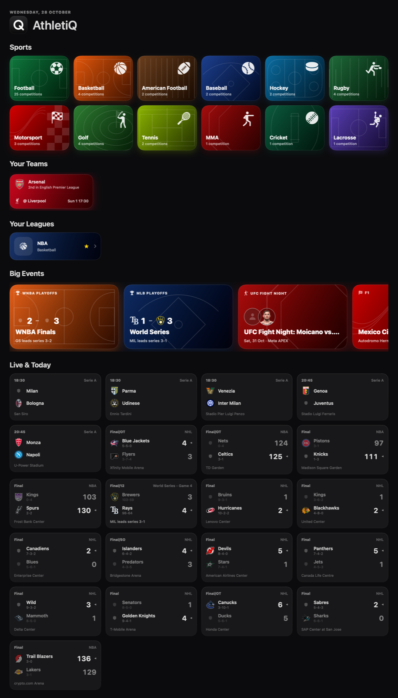
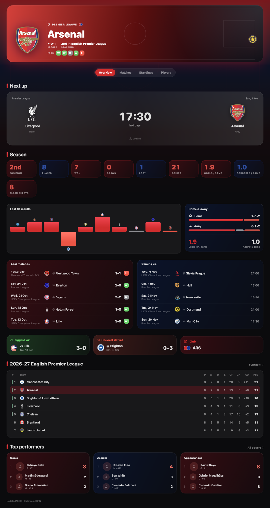
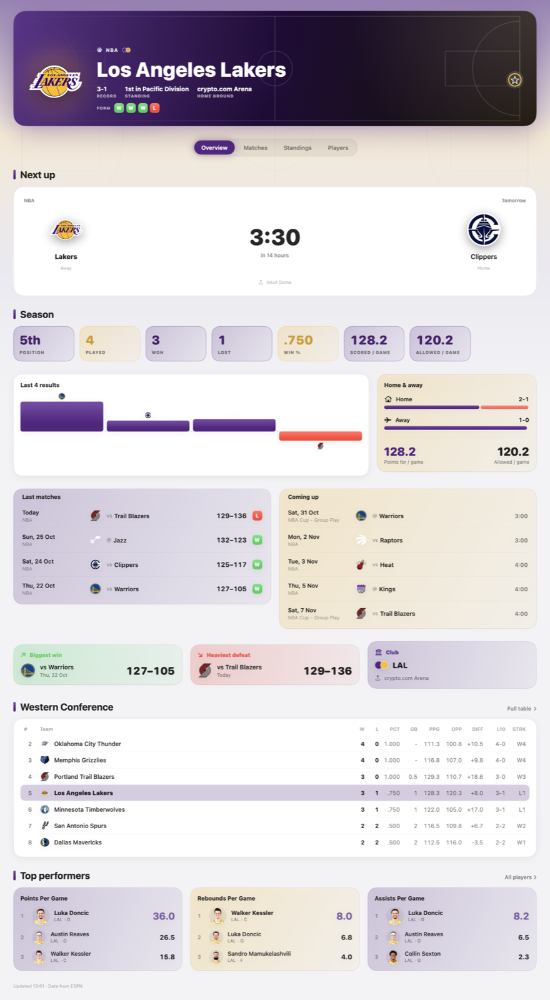
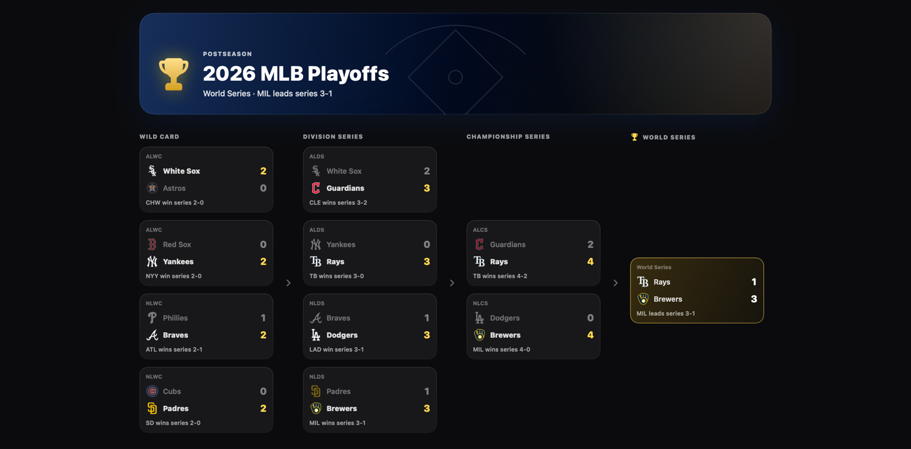
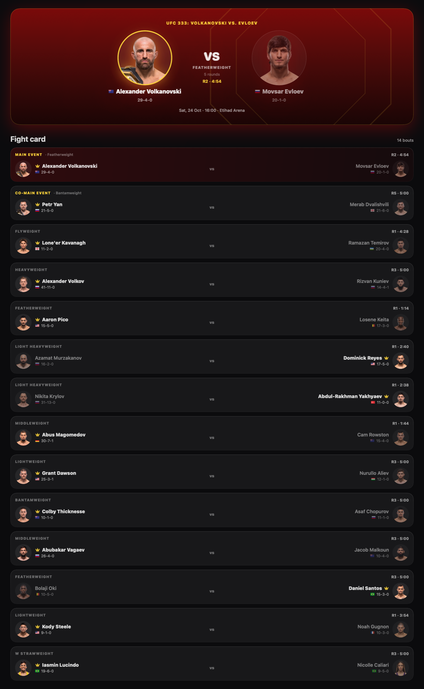
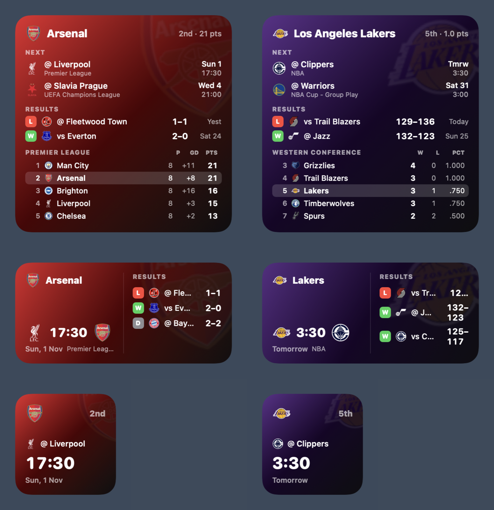

<p align="center"></p>

<h1 align="center">AthletiQ</h1>

<p align="center">Live scores, fixtures, standings, playoff brackets and stats for every major sport, in one Mac app, with a desktop widget for your team.</p>

<p align="center"></p>

## Download

1. Download **[AthletiQ.zip](../../releases/latest/download/AthletiQ.zip)** from the latest release.
2. Unzip it and drag **AthletiQ** into your **Applications** folder.
3. Open it. macOS shows a warning that Apple can't verify the app, because it isn't distributed through the App Store. Click **Done**.
4. Open **System Settings › Privacy & Security**, scroll down, and click **Open Anyway** next to the AthletiQ message. Confirm with your password.
5. AthletiQ opens, and from now on it opens normally.

If you're comfortable with Terminal, this single command does the same as steps 3–4:

```bash
xattr -dr com.apple.quarantine /Applications/AthletiQ.app
```

**Requirements:** macOS 15 Sequoia or later, on an Apple Silicon or Intel Mac.

### Add the widget

Right-click your desktop › **Edit Widgets** › search **AthletiQ** › drag the size you want onto the desktop.
To choose your team, right-click the widget › **Edit Widget** › pick a league and a team.

### Updating

When a new version is out, download the new zip from the latest release and replace the app in Applications.

## What's inside

- **Football** (25 leagues and cups: Premier League, LaLiga, Serie A, Bundesliga, Ligue 1, Champions League and more), **NBA, WNBA, NFL, MLB, NHL** and college sports, **rugby**, **Formula 1, NASCAR, IndyCar**, **golf**, **tennis**, **UFC**, **cricket** and **lacrosse**
- Live scores that update during games, fixtures, results and full standings
- Team pages in club colours with season stats, form, home/away splits and player leaders
- Playoff brackets, UFC fight cards, race weekends, golf leaderboards and tennis draws
- Favourite teams and leagues pinned on the home screen
- Light and dark mode, following your system setting
- Desktop widget in three sizes for any team, with tinted-mode support

| Team page | Light mode |
|---|---|
|  |  |

| Playoffs | Fight card |
|---|---|
|  |  |

<p align="center"></p>

## Build from source

Open `AthletiQ.xcodeproj` in Xcode 26 or later and run the **AthletiQ** scheme.

## Notes

Scores and stats come from ESPN's public data feeds. AthletiQ isn't affiliated with ESPN or any league or team, and team names and logos belong to their owners. This is a personal project shared with friends.
